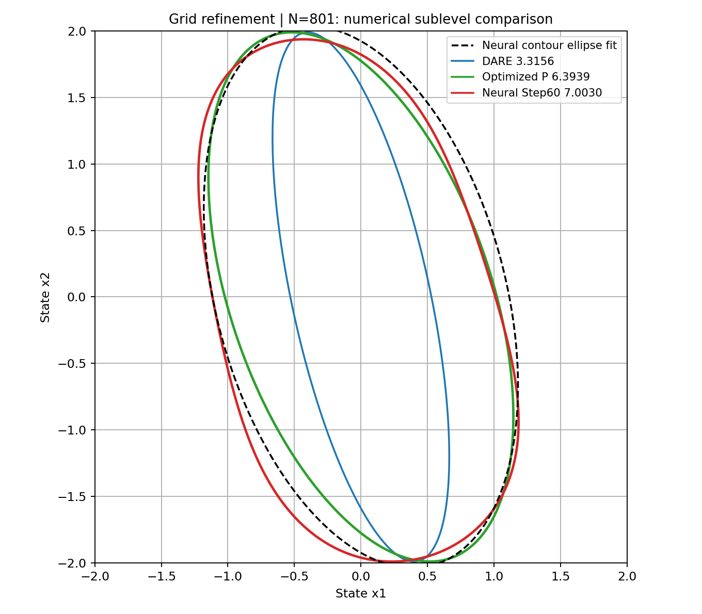
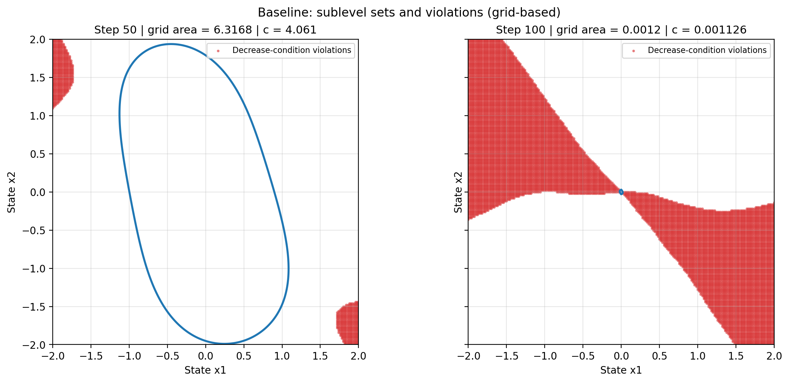
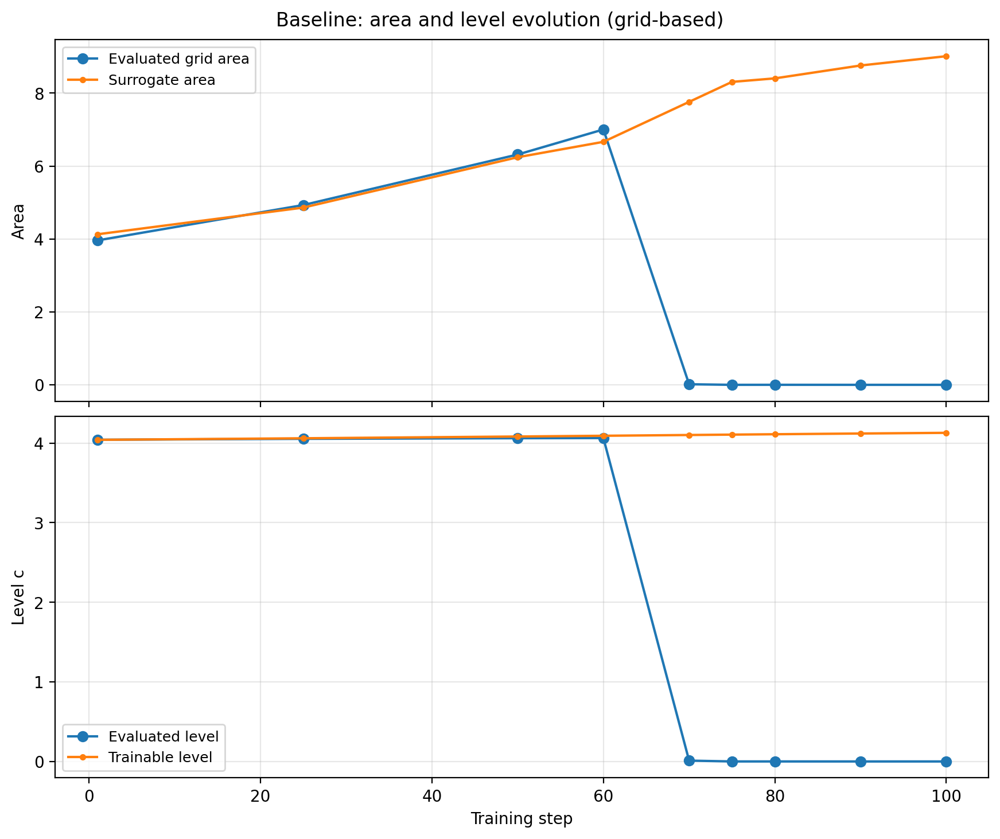
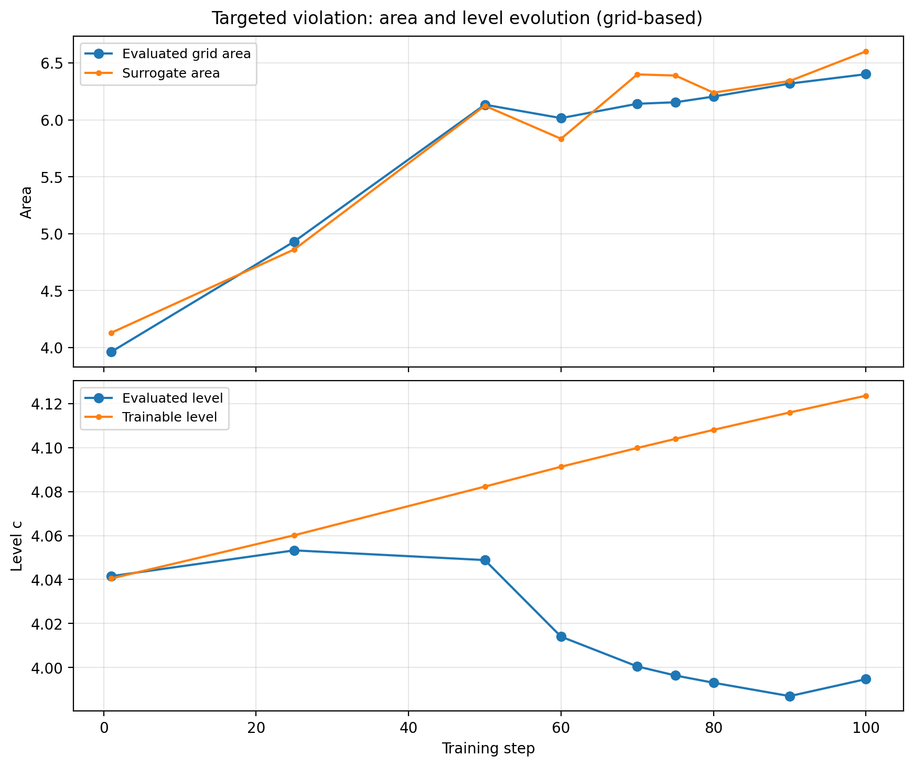
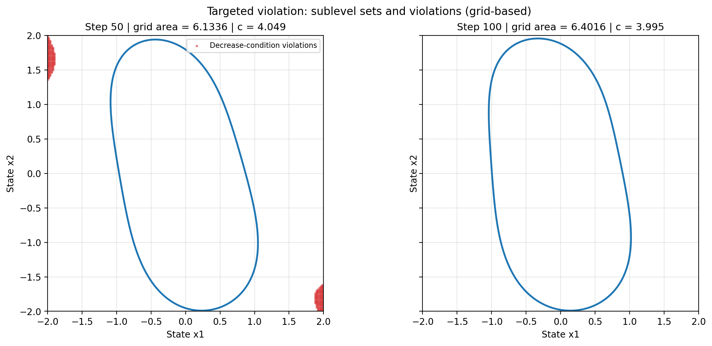
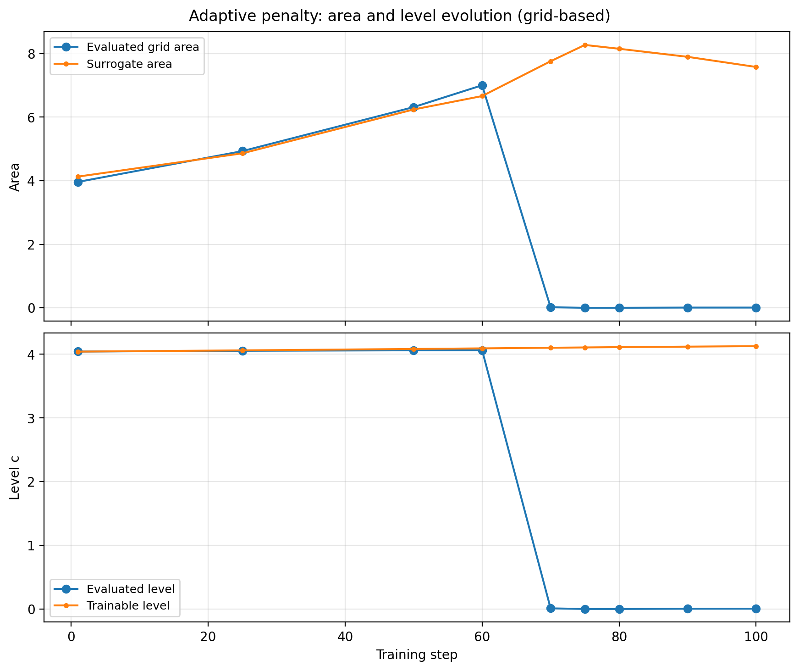
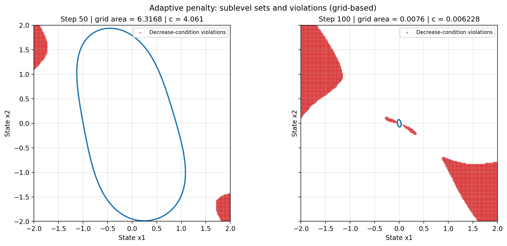

# Numerical Enlargement of Stability-Assessment Regions Using Neural Lyapunov Functions

[日本語版 README / Japanese README](README_ja.md)

## 1. Introduction

### 1.1 Background and motivation

For nonlinear control systems, identifying the set of initial states from which trajectories converge to an equilibrium—the **region of attraction (ROA)**—is important for assessing the operating range and design margins of a controller. Lyapunov functions provide a standard approach to estimating subsets of an ROA by examining the decrease of a scalar function along system trajectories.

For linear systems, a quadratic function $V(x)=x^\top Px$ is a common choice. For nonlinear systems, it is also natural to construct a quadratic function from the linearized dynamics near an equilibrium and evaluate its decrease under the original nonlinear dynamics. However, the sublevel sets of a positive-definite quadratic function are ellipsoids (ellipses in two dimensions). Even after optimizing their shape, these sets can provide conservative estimates. Accordingly, this study uses both the quadratic function obtained from the LQR Riccati equation and an **area-optimized quadratic function** as reference methods.

A neural network can represent Lyapunov-function candidates whose sublevel sets are not restricted to ellipsoids. Such **Neural Lyapunov functions** may reduce the conservatism of numerical region estimates. Previous studies have explored neural Lyapunov learning and ROA estimation [1, 2]. Nevertheless, greater representational flexibility does not by itself ensure that training will find a large region satisfying a Lyapunov decrease condition.

The following figure previews the sublevel sets considered in this study. **DARE Quadratic** (blue) uses the matrix from LQR design, **Optimized Quadratic** (green) optimizes the shape of a quadratic function for area, and **Neural Lyapunov** (red) uses a learned nonlinear function. The central question is whether the additional flexibility of the neural representation yields a larger numerically evaluated region **for the same closed-loop dynamics**. Quantitative results are presented in Section 6.1.



*Sublevel-set comparison on Grid 801. Blue: DARE Quadratic; green: Optimized Quadratic; red: Neural Lyapunov; black dashed curve: an ellipse fitted to the neural contour. The green and red regions are not nested.*

### 1.2 Objectives and engineering significance

This study is a numerical investigation of **Lyapunov-function construction and region evaluation for a fixed nonlinear closed-loop system**, without modifying the controller. It addresses two questions:

1. **Region enlargement:** Can a Neural Lyapunov function produce a larger numerically evaluated sublevel set than an area-optimized quadratic function?
2. **Training robustness:** Why can the differentiable area surrogate used for training diverge from the grid-based area evaluated using the decrease condition, and can the resulting collapse of the evaluated area be mitigated?

The first question concerns conservatism associated with the shape restriction of quadratic functions. The second concerns the alignment between the training objective and the decrease-based evaluation metric. The aim is to numerically enlarge candidate regions for stability assessment, **not** to demonstrate improved controller performance or provide a formal stability certificate.

### 1.3 Related work and scope

Learning Neural Lyapunov functions and estimating stability regions are established research topics. Richards et al. [1] studied stability certification using learned Lyapunov functions, while Zhou et al. [2] investigated learning and verification in neural Lyapunov control. This work therefore **does not claim the use of Neural Lyapunov functions or their nonquadratic expressiveness as a new theoretical contribution**.

Instead, it compares (i) an LQR-derived quadratic function, (ii) a numerically area-optimized quadratic function, and (iii) a Neural Lyapunov function under a common evaluation rule for one nonlinear closed-loop system. It also diagnoses the **discrepancy between surrogate area and grid-evaluated area** during training and investigates an additional penalty focused on violating states with low Lyapunov-function values.

The related personal repository [*Diagnosing SAC Learning Against an Analytical LQR Reference — Comparing the Actor and Twin Critics*](https://github.com/ynagira-lab/sac_lqr_diagnostics) compares SAC actor outputs and twin-critic action values at 100k and 300k training steps against an analytical LQR reference for a **linear-quadratic control problem**. The present study continues the broader interest in combining model-based and learning-based control, but uses **a different nonlinear example and a Residual SAC controller**, shifting the focus from control-performance diagnostics to Lyapunov-based region evaluation. It does not reuse the trained SAC models from that repository.

**References**

[1] S. M. Richards, F. Berkenkamp, A. Krause, “The Lyapunov Neural Network: Adaptive Stability Certification for Safe Learning of Dynamical Systems,” *Proceedings of Machine Learning Research*, vol. 87, pp. 466–476, 2018. https://proceedings.mlr.press/v87/richards18a.html

[2] R. Zhou, T. Quartz, H. De Sterck, J. Liu, “Neural Lyapunov Control of Unknown Nonlinear Systems with Stability Guarantees,” *NeurIPS*, 2022. https://papers.neurips.cc/paper_files/paper/2022/hash/bba3160c42f4c1d23175b5abf04347f5-Abstract-Conference.html

## 2. Problem Formulation

### 2.1 Nonlinear dynamics and controller

Although Lyapunov-based assessment is applicable to systems of higher dimension, this study considers a two-dimensional discrete-time nonlinear system for ease of interpretation and visualization. With state $x_k=[x_{1,k},x_{2,k}]^\top\in\mathbb R^2$ and scalar input $u_k\in\mathbb R$, the dynamics are

```math
x_{k+1}=Ax_k+Bu_k+d(x_k),
```math

```math
A=\begin{bmatrix}1&0.1\\0&1\end{bmatrix},\qquad
B=\begin{bmatrix}0\\0.1\end{bmatrix},\qquad
d(x)=\begin{bmatrix}0\\0.02x_1^3\end{bmatrix}.
```math

Here $A$ and $B$ describe the linear part, while $d(x)$ is a **known nonlinear term**, not an unknown disturbance.

The controller combines a baseline LQR controller designed for the linear model with a correction generated by a pretrained Residual SAC policy. First, infinite-horizon discrete-time LQR is designed for $d(x)=0$, with $Q=\mathrm{diag}(1,0.1)$ and $R=0.01$. The gain $K$ is obtained from the discrete algebraic Riccati equation (DARE). LQR is optimal **for this specified linear model and cost function**, not necessarily for the original nonlinear system.

A state-dependent correction $\pi(x)$ is learned using Soft Actor-Critic (SAC), a reinforcement-learning algorithm. The correction is not assumed to cancel the nonlinear term exactly. Subtracting $\pi(0)$ makes the residual input zero at the origin.

The Residual SAC model used here is `residual_sac_nonlinear_100k.zip`, trained for 100,000 steps using `residual_sac_training.py`. Its parameters are fixed throughout subsequent Lyapunov-function learning and evaluation. Training conditions and reproduction instructions are given in Sections 5 and 7.

```math
u_k=-Kx_k+\bigl(\pi(x_k)-\pi(0)\bigr).
```math

Thus, the **fixed closed-loop system** evaluated throughout this study is

```math
x_{k+1}=f_{\mathrm{cl}}(x_k)
=(A-BK)x_k+B\bigl(\pi(x_k)-\pi(0)\bigr)+d(x_k).
```math

Because $d(0)=0$, the origin is an equilibrium. Removing the residual term would give the LQR-only closed loop, but **none of the three Lyapunov-function comparisons in this study removes the residual correction**.

### 2.2 Separating controller design from Lyapunov-function evaluation

Controller design and post-design region assessment are distinct tasks. The LQR + Residual SAC controller defined above remains fixed: $K$, $\pi$, and $f_{\mathrm{cl}}$ are unchanged across the three methods.

Only the candidate function $V$ changes: (i) a quadratic function using the DARE solution from LQR design; (ii) a quadratic function whose matrix $P$ is optimized for area; or (iii) a learned Neural Lyapunov function. **“DARE Quadratic” identifies the source of the Lyapunov-function matrix; it does not indicate an LQR-only controller.**

The DARE solution directly corresponds to the linear LQR design problem. For the nonlinear closed loop containing the Residual SAC policy, the Lyapunov decrease condition must be evaluated separately for every candidate. The common numerical evaluation rule is defined next.

## 3. Lyapunov-Based Region Estimation

### 3.1 Lyapunov functions, sublevel sets, and candidate families

Consider $x_{k+1}=f_{\mathrm{cl}}(x_k)$ with an equilibrium at the origin. A candidate Lyapunov function should be **positive definite** and decrease along trajectories within the region under consideration. For example,

```math
V(0)=0,\qquad V(x)>0\quad(x\ne0),
```math

```math
V(f_{\mathrm{cl}}(x))-V(x)\le-\alpha\|x\|_2^2\quad(\alpha>0)
```math

provide a basis for stability assessment when established on an appropriate region. The latter is the decrease condition selected for this experiment; it is not a universal requirement for all Lyapunov functions.

A **sublevel set** at threshold $c>0$ is

```math
\Omega_c(V)=\{x:V(x)\le c\}.
```math

For a two-dimensional quadratic function, this is an elliptical region. Increasing $c$ enlarges the set, but a larger set cannot be treated as a stability region without checking the decrease condition throughout it. The numerical objective here is to compare areas of sublevel sets selected using a grid-based decrease-condition test.

**(i) DARE Quadratic: LQR-derived reference**

```math
V_{\mathrm{DARE}}(x)=x^\top P_{\mathrm{DARE}}x.
```math

$P_{\mathrm{DARE}}$ is the Riccati solution for the linear model in Section 2.1. It arises when calculating the LQR gain $K$ and **is not optimized to maximize the evaluated region for the nonlinear closed loop**.

**(ii) Optimized Quadratic: area-oriented ellipse optimization**

```math
V_Q(x)=x^\top Px,\qquad P\succ0.
```math

The controller gain $K$ is unchanged; only the matrix $P$ used for region assessment is varied. Changing $P$ changes the orientation and aspect ratio of the ellipse and may change the area of its sublevel set satisfying the numerical decrease test. This is a comparison between **Lyapunov-function choices for the same closed-loop dynamics**, not between different controllers.

Multiplying $P$ by a positive scalar $a$ multiplies $V_Q$ by $a$. Scaling the threshold to $ac$ leaves the sublevel set unchanged: $x^\top Px\le c$ and $x^\top(aP)x\le ac$ describe the same set. To remove this scaling redundancy and search over ellipse shape, the implementation normalizes $\det P=1$. This is a numerical optimization convention, **not** a general Lyapunov condition.

Using a rotation matrix $R(\phi)$, write

```math
P(\phi,r)=R(\phi)\begin{bmatrix}e^r&0\\0&e^{-r}\end{bmatrix}R(\phi)^\top.
```math

This parameterization ensures $P\succ0$ and $\det P=1$, leaving two search variables: rotation angle $\phi$ and shape parameter $r$. For each candidate $P$, the grid-based area from Section 3.2 is evaluated and numerically maximized using **differential evolution** (`scipy.optimize.differential_evolution`). This derivative-free method is suitable for the nonsmooth grid-based objective. “Optimized” means the best candidate found under the specified numerical search settings; **global optimality is not established**.

**(iii) Neural Lyapunov: learning a flexible function shape**

```math
V_\theta(x)=\|x\|_2^2+\bigl(g_\theta(x)-g_\theta(0)\bigr)^2.
```math

Here $g_\theta$ is a trainable neural network. The first term is strictly positive away from the origin, the second is nonnegative, and both vanish at the origin. Thus, **positive definiteness follows from the construction**. Decrease is not guaranteed by the architecture; it is encouraged during training through the numerical decrease condition. The network architecture is an experimental choice rather than a claim of architectural optimality.

All three candidates are evaluated under the **same $f_{\mathrm{cl}}$ from Section 2.1**. They differ only in how the scalar function is constructed.

### 3.2 Numerical area evaluation using the decrease condition

The goal is to enlarge a sublevel set while avoiding states that violate the decrease condition. This section defines the common procedure for selecting a threshold $c$ and approximating the resulting area on a finite grid.

**Step 1: Evaluate the decrease condition numerically.** Define

```math
m(x)=V(f_{\mathrm{cl}}(x))-V(x)+\alpha\|x\|_2^2,\qquad\alpha=0.05.
```math

The condition $m(x)\le0$ requires $V$ to decrease by at least $\alpha\|x\|_2^2$ along one closed-loop transition. The experimental value is $\alpha=0.05$.

Let the search domain be $\mathcal X=[-2,2]^2$. Denote by $G_N$ the grid with $N$ points on each axis and by $\partial G_N$ its boundary grid points. To account for floating-point behavior near the origin, define the set of detected violations as

```math
B_N=\{x\in G_N:\|x\|_2^2>10^{-20},\ m(x)>10^{-8}\}.
```math

The first tolerance excludes points extremely close to the origin, and the second treats very small positive residuals as numerical tolerance. **These are implementation thresholds, not a relaxation that establishes a theoretical Lyapunov guarantee.**

**Step 2: Select the sublevel-set threshold.** Two limits restrict the admissible threshold.

First, to avoid including a detected violating state, use the smallest Lyapunov-function value among the violating grid points:

```math
c_{\mathrm{violation}}=\min_{x\in B_N}V(x),\qquad B_N\ne\varnothing.
```math

Second, to stop the evaluated sublevel set before it reaches the edge of the finite search domain, use

```math
c_{\mathrm{boundary}}=\min_{x\in\partial G_N}V(x).
```math

Taking the more restrictive limit and applying a numerical margin of 0.99 gives

```math
c_{\mathrm{eval}}=
\begin{cases}
0.99\min\{c_{\mathrm{boundary}},c_{\mathrm{violation}}\},& B_N\ne\varnothing,\\
0.99c_{\mathrm{boundary}},& B_N=\varnothing.
\end{cases}
```math

For example, if the minimum boundary value is 5 and the minimum violation value is 3, then $c_{\mathrm{eval}}=2.97$. If there are no detected violations and the boundary minimum is 5, then $c_{\mathrm{eval}}=4.95$: **the boundary restriction still applies when no violations are found**. The implementation clips values to nonnegative values where necessary.

The factor 0.99 is a heuristic numerical margin. It does not certify decrease between grid points or exact positive invariance. The chosen domain $[-2,2]^2$ is a common comparison setting rather than a proven optimal domain; changing its extent can change the boundary limit, detected violations, and optimized areas.

**Step 3: Approximate the area.** Select the grid points satisfying the evaluation threshold:

```math
\Omega_N=\{x\in G_N:V(x)\le c_{\mathrm{eval}}\},
\qquad
A_{\mathrm{grid}}=\#\Omega_N\left(\frac{4}{N-1}\right)^2.
```math

Here $\#\Omega_N$ is the number of selected grid points and $4/(N-1)$ is the grid spacing along each axis. The resulting value is a **finite-grid area approximation**, not an exact continuous-area calculation.

This shared procedure allows a quantitative comparison of Lyapunov-function candidates under identical closed-loop dynamics, search domain, and numerical evaluation rules. **It does not establish decrease or positive invariance over the continuous region.** Grid-resolution sensitivity is examined in Section 6.

## 4. Neural Lyapunov Optimization

### 4.1 Trainable quantities and state samples

This stage uses **gradient-based optimization with Adam**, not SAC reinforcement learning. SAC is used beforehand to train the controller's residual component, which remains fixed here. The trainable quantities are the neural-network parameters $\theta$ and a training threshold $c_{\mathrm{train}}$ used in the area surrogate.

State samples $x_i$ are drawn from a pool containing **8,192 uniformly sampled points in $[-2,2]^2$ and the points of a 201 × 201 grid**. Up to 4,096 points are selected from this pool at each training step. Thus, training samples are neither exclusively grid points nor exclusively newly generated random points. For each sampled state, the fixed map $f_{\mathrm{cl}}(x_i)$ is evaluated and the difference between $V_\theta(x_i)$ and $V_\theta(f_{\mathrm{cl}}(x_i))$ is used to evaluate decrease. **No supervised target values for the Lyapunov function are supplied.**

The network $g_\theta$ is a fully connected Tanh network with architecture **2 → 64 → 64 → 1**, mapping the two-dimensional state to a scalar. It is inserted into the positive-definite construction in Section 3.1. The decrease condition is encouraged numerically through the training loss; the architecture itself does not guarantee decrease.

### 4.2 Surrogate area and training loss

The grid-based area in Section 3.2 involves a minimum over violating points and discrete point counting, making it unsuitable for direct gradient optimization. Instead, training introduces a separate, positive, trainable threshold

```math
c_{\mathrm{train}}=\exp(\ell),
```math

where $\ell$ is an unconstrained scalar parameter.

A smooth approximation of sublevel-set membership is defined using the sigmoid function $\sigma(z)=1/(1+e^{-z})$:

```math
s_\theta(x)=\sigma\!\left(\frac{c_{\mathrm{train}}-V_\theta(x)}{T}\right),\qquad T=0.12.
```math

Values of $s_\theta(x)$ approach 1 well inside the training sublevel set, equal 0.5 near its boundary, and approach 0 outside. The temperature $T$ controls the smoothness of this transition; 0.12 is an experimental setting, not an optimized value.

Since the search domain has area 16, define the differentiable area surrogate for approximately uniformly distributed samples as

```math
A_{\mathrm{surrogate}}=16\cdot\frac{1}{M}\sum_{i=1}^{M}s_\theta(x_i).
```math

Increasing this quantity encourages more sampled states to lie inside the training sublevel set. In contrast, $A_{\mathrm{grid}}$ uses **$c_{\mathrm{eval}}$ recomputed from detected violations and the domain boundary**. Consequently, the two area measures need not agree.

The initial training method, termed **Baseline**, uses

```math
\mathcal L=-\lambda_A A_{\mathrm{surrogate}}+\lambda_V L_V+\lambda_B L_B,
```math

where the first term encourages larger surrogate area, the second penalizes violations of the decrease condition, and the third penalizes a training threshold that extends beyond the search-domain boundary. Specifically,

```math
L_V=\frac1M\sum_{i=1}^{M}s_\theta(x_i)
\frac{\mathrm{ReLU}(m(x_i))}{1+\|x_i\|_2^2},
```math

```math
L_B=\frac1{|\partial G_N|}\sum_{x\in\partial G_N}
\mathrm{ReLU}(c_{\mathrm{train}}-0.99V_\theta(x))^2.
```math

$L_V$ averages the positive decrease-condition residual, weighted by soft membership in the training sublevel set. The denominator $1+\|x\|_2^2$ scales the violation magnitude. $L_B$ penalizes cases where $c_{\mathrm{train}}$ exceeds $0.99V_\theta(x)$ on the search boundary. **Both are soft penalties, not hard constraints**, and neither ensures the complete absence of violations.

The experimental weights are $\lambda_A=1$, $\lambda_V=100$, and $\lambda_B=100$. Because $L_V$ is an average, it can remain small even if a few violations occur at states with low $V$. Yet such states may impose a severe upper bound on $c_{\mathrm{eval}}$. Thus, a large surrogate area can coexist with a sharply reduced grid-evaluated area.

“Baseline” denotes this study's reference training method, not a standardized loss from prior literature.

### 4.3 Area collapse and Targeted Violation

The Baseline loss seeks to enlarge the region while suppressing violations **on average**. However, a small $L_V$ does not exclude violating grid points with low $V_\theta(x)$. Under the evaluation rule in Section 3.2, the smallest Lyapunov-function value among violations limits $c_{\mathrm{eval}}$. Therefore, a small average violation loss does **not** imply a large evaluation threshold.

In the Baseline experiment, surrogate area continued to grow while grid-evaluated area collapsed (Section 6.2). To address this mismatch, **Targeted Violation** explicitly emphasizes detected violating states with low Lyapunov-function values. Its purpose is not merely to reduce the total number of violations but to improve the states most likely to constrain the evaluation threshold.

With $\mathcal L_{\mathrm{base}}$ denoting the Baseline loss, the targeted objective is

```math
\mathcal L_{\mathrm{targeted}}=\mathcal L_{\mathrm{base}}+300L_{\mathrm{target}}.
```math

A fixed **51 × 51 anchor grid**, obtained by selecting every fourth point along each axis of the 201 × 201 evaluation grid, is used to detect violations. Among the violating anchor points, up to 64 with the smallest $V_\theta(x)$ are selected into a set $S$. Define

```math
L_{\mathrm{target}}=\frac{1}{|S|}\sum_{x\in S}\mathrm{ReLU}(m(x)+\delta)^2,\qquad\delta=0.002.
```math

If $S$ is empty, $L_{\mathrm{target}}=0$. The parameter $\delta$ encourages an additional decrease margin at selected states. Selection and sorting of the points are detached from gradient computation; the loss evaluated at the selected points is used to update the network. The anchor grid is used **during training only**; final evaluation still uses the full 201 × 201 grid.

This term focuses training on low-$V$ violations that may be underweighted by the average loss. Section 6.3 examines whether it prevents a sharp decrease in $c_{\mathrm{eval}}$. It remains a finite-grid numerical intervention, not a certificate of continuous-state decrease.

### 4.4 Additional experiment: Adaptive penalty

A complementary experiment tests whether increasing the weight on the **average** violation loss alone can prevent area collapse. Adaptive penalty replaces the fixed Baseline weight $\lambda_V=100$ with a step-dependent weight $\lambda_V(k)$:

```math
\mathcal L_{\mathrm{adaptive}}=-\lambda_A A_{\mathrm{surrogate}}+\lambda_V(k)L_V+\lambda_B L_B.
```math

In `adaptive_penalty_training.py`, the weight starts at 100. After the Adam update at designated checkpoints, the training-batch $L_V$ is evaluated. If $L_V>10^{-5}$, the weight is multiplied by 1.5, up to a maximum of $10^7$; otherwise it is maintained using the default decay factor of 1.0. The updated weight applies from the following training step. The checkpoints are Steps 1, 25, 50, 60, 70, 75, 80, 90, and 100.

Unlike Targeted Violation, this method does not change how violating points are selected; it changes only the weight on the average loss. It therefore does not directly address low-$V$ violations. Its results are presented in Section 6.4. Failure under this experimental configuration does not establish that adaptive penalties are ineffective in general.

## 5. Experimental Setup

The fixed closed-loop system, candidate functions, training configuration, and evaluation conditions are summarized below. **Area comparison** and **mitigation of late-stage training collapse** are separate experiments and should not be conflated.

| Item | Setting |
|---|---|
| State dimension | 2 ($x_1$, $x_2$) |
| Closed loop | LQR + origin-centered Residual SAC + nonlinear dynamics |
| Residual SAC | Fixed policy trained for 100,000 steps using `residual_sac_training.py` (seed 0; residual action range ±0.5; see Section 7) |
| Search domain | $[-2,2]^2$ |
| Grids | 201 / 401 / 801 for grid refinement; 201 for training diagnostics |
| Lyapunov decrease margin | $\alpha=0.05$ |
| Neural architecture | 2–64–64–1, Tanh |
| Initial weights | Pretrained Neural Lyapunov weights (Section 7) |
| Optimization | Adam, learning rate $2\times10^{-4}$, 100 steps per method |
| Training samples | Pool of 8,192 uniformly sampled points and evaluation-grid points; up to 4,096 selected per step |
| Optimized Quadratic | $\det P=1$; differential evolution; `maxiter=100` |
| Random seed | 0 |
| Evaluation scope | Finite-grid numerical assessment; no formal certificate |

**(A) Grid refinement.** The Neural Lyapunov weights saved at **Step 60**, when the Baseline training run reached its maximum Grid-201 area of 7.0036, are held fixed and reevaluated on Grids 201, 401, and 801. DARE Quadratic and Optimized Quadratic are evaluated for comparison. This tests **grid-resolution dependence for a fixed model**, rather than directly comparing Step 60 with Step 100.

**(B) Area collapse and mitigation.** Starting from the same initial weights, Baseline and Targeted Violation are trained for 100 steps. Surrogate area, grid-evaluated area, evaluation threshold, and violation counts are compared to assess whether Targeted Violation maintains the evaluated area at the final step. Adaptive penalty is included as a complementary comparison that changes the weight on the average violation loss.

The maximum area at Step 60 and final area at Step 100 serve different purposes. In particular, Step 60 of Adaptive penalty and Step 100 of Targeted Violation must not be interpreted as successive checkpoints of the same training run.

## 6. Results and Discussion

This section compares quadratic and neural candidates under the same closed loop (Section 6.1), examines Baseline area collapse (Section 6.2), evaluates Targeted Violation (Section 6.3), and presents Adaptive penalty as a complementary comparison (Section 6.4). Limitations and future directions follow in Section 6.5. All results are based on finite-grid numerical evaluation.

### 6.1 Quadratic versus Neural Lyapunov: grid refinement

For the same nonlinear closed-loop system, DARE Quadratic, area-optimized Quadratic, and the Neural Lyapunov function saved at **Baseline Step 60** are compared. Neural weights are held fixed while grid resolution is increased from 201 to 401 and 801 points per axis.

| Method | Grid 201 | Grid 401 | Grid 801 |
|---|---:|---:|---:|
| DARE Quadratic | 3.316400 | 3.315900 | 3.315575 |
| Optimized Quadratic | 6.402000 | 6.395300 | 6.393925 |
| Neural (Baseline Step 60) | **7.003600** | **7.003200** | **7.003050** |
| Neural / Optimized | 1.09397 | 1.09505 | **1.09527** |

On Grid 801, the Neural Lyapunov candidate has an evaluated area approximately **9.53% larger** than Optimized Quadratic. The area difference remains nearly constant as the grid is refined. However, **the two sublevel sets are not nested**.


*Figure 1. DARE Quadratic (blue), Optimized Quadratic (green), Neural Step 60 (red), and an ellipse fitted to the neural contour (black dashed).*

For the Grid-801 Neural result, the reported diagnostics include zero detected violations among sampled points inside the selected set, one connected component under 8-neighbor connectivity, no contact with the search boundary, and an ellipse-fit RMSE of approximately 0.116. These observations suggest that nonquadratic shape flexibility may be useful, but they do not isolate shape difference as the sole cause of the area improvement.

### 6.2 Area collapse in Baseline training

With the fixed-weight Baseline loss in Section 4.2, the surrogate area increased while the grid-evaluated area contracted to nearly zero during late-stage training. **Improving a differentiable area objective does not necessarily enlarge the region selected by a decrease-based evaluation rule.**



*Figure 2. Baseline sublevel sets (blue) and decrease-condition violations over the full evaluation grid (red) at Steps 50 and 100. At Step 100, the evaluation threshold fell to 0.001126, reducing the selected set to a small neighborhood of the origin. Red points are not necessarily inside the selected blue set.*



*Figure 3. Baseline surrogate area, grid-evaluated area, training threshold, and evaluation threshold. After Step 60, surrogate area and training threshold continue to increase, while evaluated area and evaluation threshold drop sharply around Step 70.*

On Grid 201, the Baseline run reached a maximum grid-evaluated area of **7.0036 at Step 60**, then fell to **0.0012 at Step 100**. At Step 100, surrogate area was **9.0132**. The training threshold was **4.128555**, whereas the evaluation threshold fell to **0.001126**. A total of **11,861** decrease-condition violations were detected across the full evaluation grid.

This discrepancy follows from the difference between the **average violation penalty** in $L_V$ and the **minimum Lyapunov-function value among violating states** used to limit $c_{\mathrm{eval}}$. Even a small number of low-$V$ violations can sharply restrict the evaluation threshold while surrogate area grows. The reported violation count refers to the **entire evaluation grid**, not the interior of the selected sublevel set.

### 6.3 Mitigating area collapse with Targeted Violation

The Baseline results indicate that reducing the average violation loss is insufficient to suppress the low-$V$ violations that limit the evaluation threshold. Targeted Violation prioritizes such states detected on a coarser anchor grid and applies an additional penalty to improve their decrease residuals. In this experiment, the evaluation threshold did not undergo the same sharp collapse, and a substantial evaluated area remained at Step 100. This is an interpretation of numerical results, **not a formal proof of a causal mechanism**.

Results for Targeted Violation on Grid 201 over 100 training steps are shown below.

| Step | Grid area | Training $c_{\mathrm{train}}$ | Evaluation $c_{\mathrm{eval}}$ | Violations on full grid |
|---:|---:|---:|---:|---:|
| 50 | 6.1336 | 4.082253 | 4.048849 | 251 |
| 60 | 6.0156 | 4.091294 | 4.014027 | 0 |
| 70 | 6.1416 | 4.099814 | 4.000496 | 13 |
| 100 | **6.4016** | 4.123591 | **3.994717** | **0** |

At Step 100, surrogate area was **6.6020** and grid-evaluated area was **6.4016**, a difference of **0.2004** (approximately **3.04%** of surrogate area). Both quantities use the same definitions as in Baseline. Focusing the additional loss on low-$V$ violations avoided the extreme discrepancy between the training and evaluation thresholds in this experiment.



*Figure 4. Targeted Violation area and threshold trajectories. The evaluation threshold remained close to 4 during late-stage training.*



*Figure 5. Sublevel sets and detected decrease-condition violations at Steps 50 and 100. No violations were detected on the full 201 × 201 evaluation grid at Step 100; this is not a guarantee over continuous state space.*

**Comparison with Baseline.** At Step 100, grid-evaluated area was **0.0012** for Baseline versus **6.4016** for Targeted Violation. The evaluation thresholds were **0.001126** and **3.994717**, respectively; full-grid violation counts were **11,861** and **0**. These results demonstrate numerical improvement under the same grid-based evaluation, not formal stability certification.

### 6.4 Comparison with Adaptive penalty

Adaptive penalty tests whether dynamically increasing the weight on the average violation loss can prevent collapse. Unlike Targeted Violation, it does not add a loss focused on low-$V$ violating states.

| Step | Grid area | Evaluation $c_{\mathrm{eval}}$ | Violations on full grid |
|---:|---:|---:|---:|
| 50 | 6.3168 | 4.061067 | 841 |
| 60 | **7.0036** | 4.062973 | 3,590 |
| 70 | 0.0172 | 0.011553 | 7,725 |
| 100 | **0.0076** | 0.006228 | 5,066 |



*Figure 6. Adaptive penalty training trajectories. After Step 70, surrogate area remained large while grid-evaluated area and the evaluation threshold decreased sharply.*



*Figure 7. Adaptive penalty sublevel sets and detected violations at Steps 50 and 100; these are not the Baseline plots.*

At Step 100, surrogate area was **7.5805**, versus a grid-evaluated area of **0.0076**. Adaptive penalty briefly achieved an area of **7.0036 at Step 60**, but the final evaluated area collapsed. Under these settings, **increasing the average violation-loss weight alone was insufficient**. The Targeted Violation final area of 6.4016 is smaller than Adaptive penalty's best intermediate area of 7.0036. Its distinguishing result is **mitigation of late-stage collapse**, not a new maximum area.

### 6.5 Summary and future work

The **first result** is enlargement of the numerically evaluated sublevel set using a Neural Lyapunov function. On Grid 801, the Neural area was **7.003050** versus **6.393925** for Optimized Quadratic, an improvement of approximately **9.53%**. The comparison remained nearly unchanged under grid refinement.

The **second result** is the diagnosis of area collapse and the investigation of a loss that targets its numerical bottleneck. Baseline exhibited a mismatch between an average violation penalty and the minimum-violation-value evaluation rule. Targeted Violation emphasized low-$V$ violating states and obtained a **Step-100 grid area of 6.4016 with zero detected full-grid violations**. In the complementary Adaptive penalty experiment, increasing the average violation weight alone did not prevent collapse.

These are **results from different evaluation targets**: area enlargement uses the saved Step-60 Neural model, whereas collapse mitigation is evaluated using the Targeted Violation model at Step 100. Neither constitutes a formal ROA certificate for a continuous region.

Future work includes tests on other nonlinear systems and random seeds, sensitivity to search-domain size, certification of decrease and positive invariance over continuous regions, extension to higher-dimensional systems, and sensitivity to anchor-grid density and the number of selected violating states.

## 7. Reproduction

### 7.1 Requirements, file layout, and initial training

Install `numpy`, `scipy`, `matplotlib`, `torch`, and `stable-baselines3` in the Python environment. Numerical results can depend on library versions and the computing environment; pin dependency versions as appropriate for reproducibility.

Place the Python scripts and model files in `src/`, and place figures referenced by this README in `figures/`. The following layout illustrates the files after Residual SAC training, initial Neural Lyapunov training, and saving the Step-60 checkpoint.

```text
src/
├── residual_sac_training.py
├── neural_lyapunov_initial_training.py
├── quadratic_neural_comparison.py
├── baseline_checkpoint_training.py
├── grid_refinement_validation.py
├── adaptive_penalty_training.py
├── targeted_violation_training.py
├── residual_sac_nonlinear_100k.zip          # Generated by Residual SAC training
└── out/
    ├── neural_lyapunov_initial_weights.pt   # Generated by initial Neural training
    ├── neural_initial_sublevel_metrics.csv  # Initial Neural numerical evaluation
    └── neural_lyapunov_step60_weights.pt    # Saved at Step 60
```

**1. Train the Residual SAC controller.** From `src/` as the working directory, run:

```python
%run residual_sac_training.py
```

This trains the Residual SAC policy for 100,000 steps with random seed 0 and produces `out/residual_sac_nonlinear_100k.zip`. Copy that file to `src/residual_sac_nonlinear_100k.zip`. The current `neural_lyapunov_initial_training.py` loads the model by name from the `src/` working directory, so **this copy from `out/` is required**.

**2. Train the initial Neural Lyapunov function.**

```python
%run neural_lyapunov_initial_training.py
```

The residual policy output at the origin is subtracted to preserve the equilibrium at the origin. This run produces `out/neural_lyapunov_initial_weights.pt` and `out/neural_initial_sublevel_metrics.csv`.

**3. Compare the initial Neural function with quadratic candidates.**

```python
%run quadratic_neural_comparison.py --module neural_lyapunov_initial_training.py --weights out/neural_lyapunov_initial_weights.pt --grid 201 --maxiter 100 --seed 0
```

Under the same closed-loop system and Grid-201 evaluation, the areas of DARE Quadratic, Optimized Quadratic, and the **initial** Neural Lyapunov function are **3.3164**, **6.4020**, and **3.9268**, respectively. Outputs are `out/quadratic_neural_comparison_metrics.csv` and `out/quadratic_neural_sublevel_comparison.png`.

The initial Neural model here is **not** the area-trained Step-60 model used in Section 6.1 (Grid-201 area: **7.0036**). The `--module` argument specifies the initial-training script and `--weights` specifies its saved weights.

### 7.2 Baseline area training and saving the Step-60 model

To obtain the Baseline training trajectory, run `adaptive_penalty_training.py` in fixed-penalty mode:

```python
%run adaptive_penalty_training.py --steps 100 --grid 201 --maxiter 100 --mode baseline
```

Main outputs include `adaptive_penalty_baseline_diagnostics.csv`, `adaptive_penalty_baseline_area_level.png`, and `adaptive_penalty_baseline_violation_maps.png`, corresponding to the diagnostics and figures in Section 6.2.

To generate the Step-60 checkpoint used for grid refinement, run:

```python
%run baseline_checkpoint_training.py --module neural_lyapunov_initial_training.py --weights out/neural_lyapunov_initial_weights.pt --steps 100 --grid 201 --maxiter 100
```

Example outputs are `out/neural_lyapunov_step60_weights.pt` and `out/baseline_checkpoint_diagnostics.csv`. Grid refinement uses the saved Step-60 weights without further training. The Baseline mode and checkpoint-saving script are separate execution paths; exact weight equivalence would require matching initial weights, random states, and update procedures.

### 7.3 Grid refinement

```python
%run grid_refinement_validation.py --module neural_lyapunov_initial_training.py --weights out/neural_lyapunov_step60_weights.pt --grids 201 401 801 --maxiter 100
```

This command evaluates Grids 201, 401, and 801. Example outputs are `out/grid_refinement_801_contours.png` and `out/grid_refinement_validation_metrics.csv`. Grid-801 evaluation may require additional computation time.

### 7.4 Adaptive penalty comparison

Run from the `src/` directory in Spyder:

```python
%run adaptive_penalty_training.py --steps 100 --grid 201 --maxiter 100 --mode adaptive
```

Diagnostic CSVs and figures are saved under `out/`. The grid-evaluated areas are **7.0036 at Step 60** and **0.0076 at Step 100**, as reported in Section 6.4. Figure filenames include `adaptive_penalty_adaptive_area_level.png` and `adaptive_penalty_adaptive_violation_maps.png`.

### 7.5 Targeted Violation training

```python
%run targeted_violation_training.py --steps 100 --grid 201 --maxiter 100 --mode targeted
```

On Grid 201 at Step 100, the evaluated area is **6.4016**, the evaluation threshold is **3.994717**, and **zero violations** are detected on the full evaluation grid. Main outputs include `targeted_violation_targeted_diagnostics.csv`, `targeted_violation_targeted_area_level.png`, and `targeted_violation_targeted_violation_maps.png`.

### 7.6 Execution and interpretation notes

These experiments require the fixed Residual SAC model and the initial Neural Lyapunov weights. Ensure that file placement, script-relative paths, and Python dependencies are consistent. To display generated figures in the README, copy the PNG files to the locations specified by the relative Markdown paths.

**Zero detected violations on a finite grid do not guarantee Lyapunov decrease or positive invariance over continuous state space.** All reported areas are numerical sublevel-set area estimates under the specified finite search domain and evaluation grid.
