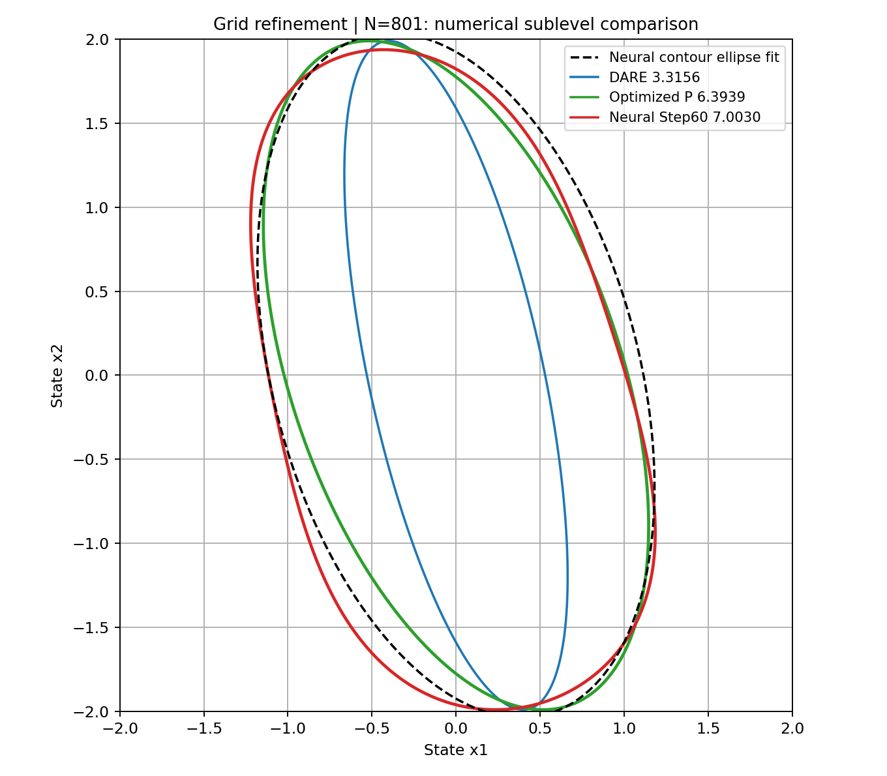
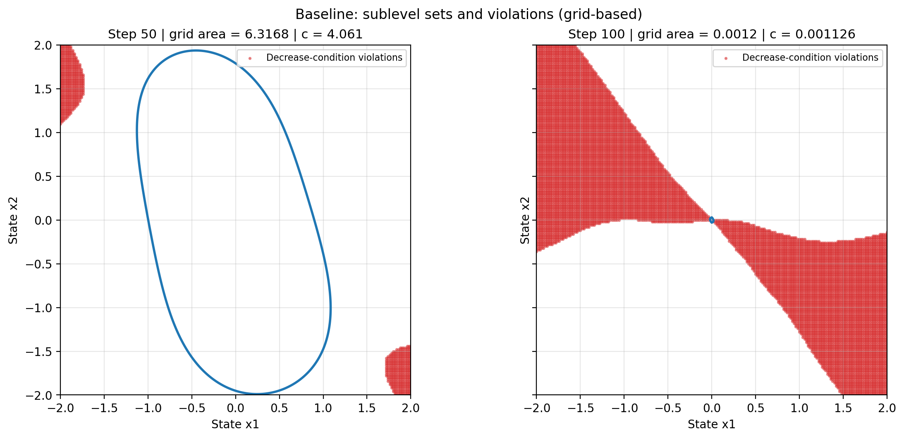
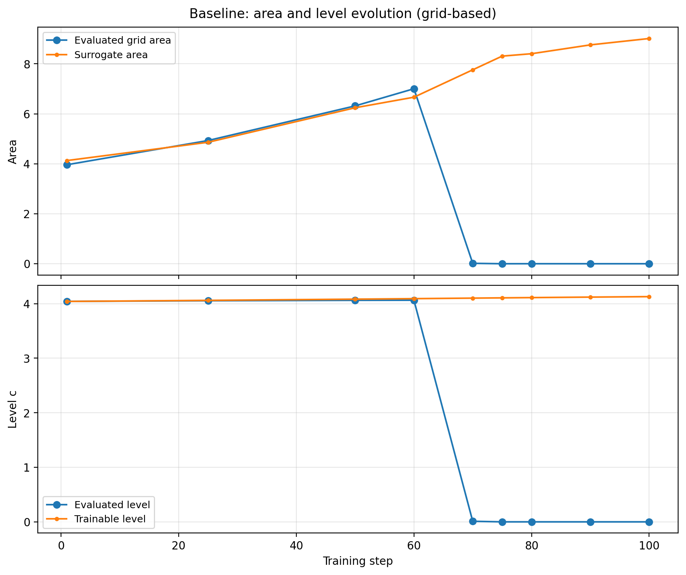
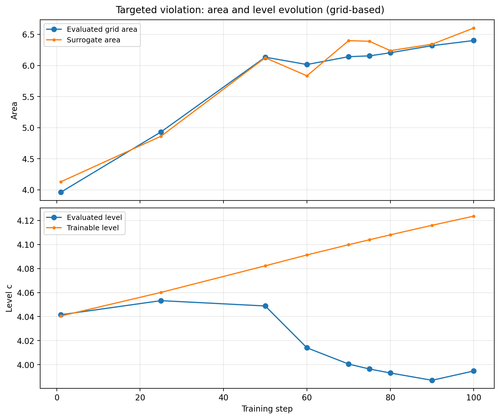
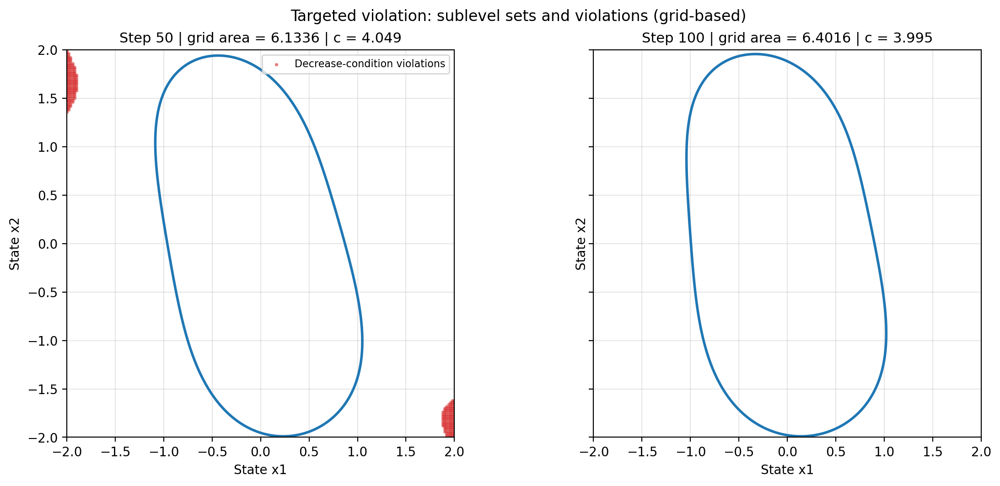
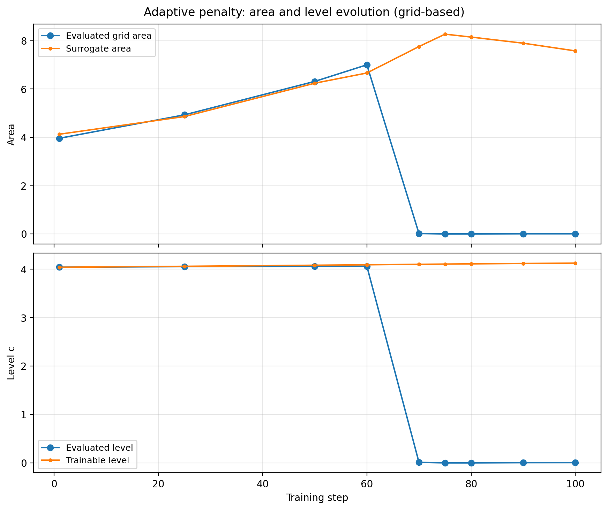
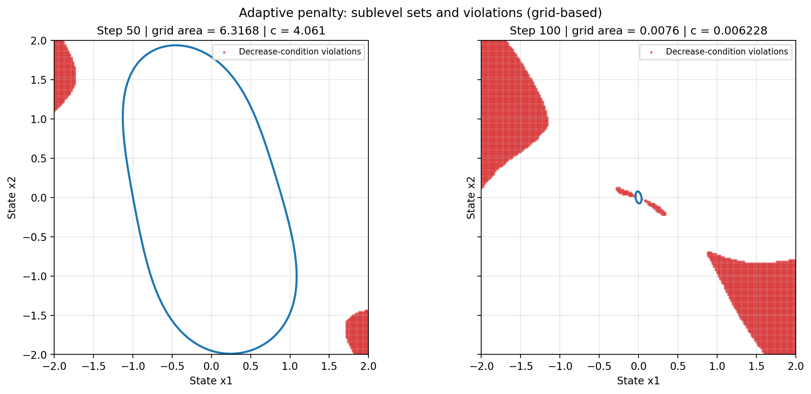

# Neural Lyapunov関数による数値的安定領域の拡大

[English README](README.md)

## 1. Introduction（背景・目的）

### 1.1 背景と課題

非線形制御系において、平衡点へ収束する初期状態の範囲（吸引領域、Region of Attraction：ROA）を把握することは、制御系の適用可能範囲や設計余裕を検討するうえで重要である。Lyapunov関数は、状態に対応するスカラー値が時間とともに減少する性質を利用し、ROAの内側に含まれる集合を評価するための代表的な手段である。

線形系では二次形式 $V(x)=x^\top Px$ がよく用いられる。非線形系に対しても、平衡点近傍の線形化モデルから二次形式を構成し、元の非線形ダイナミクスに対して減少条件を確認することは自然な出発点となる。ただし、正定値行列 $P$ による劣レベル集合は、2次元では楕円の内部に限られる。したがって、非線形系に対しては、楕円の形状を調整しても評価領域が保守的になる可能性がある。本研究では、LQRのRiccati解による二次形式に加え、**劣レベル集合の面積が大きくなるように形状を最適化した二次形式**も基準として用いる。

一方、ニューラルネットワークを用いてLyapunov関数の形状を柔軟に表現すれば、楕円だけでは捉えにくい領域も表現し、数値的な領域評価の保守性を低減できる可能性がある。このような関数候補を、本稿では**Neural Lyapunov関数**と呼ぶ。先行研究でも、ニューラルネットワークによるLyapunov関数の学習やROA推定が検討されている［1, 2］。ただし、関数の表現力が高いことと、減少条件を満たす大きな領域を実際に学習できることは別の課題である。

以下に、本研究で得られた劣レベル集合の比較を先に示す。**青色のDARE Quadratic**はLQR設計から得た二次形式、**緑色のOptimized Quadratic**は面積を目的に形状を調整した二次形式、**赤色のNeural Lyapunov**はニューラルネットワークで構成した関数である。まず緑色と赤色の領域の**形状と広がり**に注目してほしい。二次形式の輪郭は楕円形に限られるが、Neuralでは異なる形状を表現できる。**その自由度が、同じ閉ループ系で数値的な評価面積の拡大につながるか**が本研究の最初の問いである。定量比較は6.1節で行う。



*図：Grid 801での劣レベル集合の比較。青：DARE Quadratic、緑：Optimized Quadratic、赤：Neural Lyapunov、黒破線：Neural輪郭の楕円フィット。赤色と緑色の形状・面積を比較する（両者は包含関係にはない）。*

### 1.2 研究目的と工学的意義

本研究は、**制御器を変更せず、与えられた非線形閉ループ系に対するLyapunov関数の構成・評価方法を比較する**数値実験である。検証する問いは次の2点である。

1. **領域の拡大**：Neural Lyapunov関数を使うと、面積を最適化した二次形式よりも大きな数値的劣レベル集合を得られるか。
2. **学習の安定化**：学習時に用いる滑らかな面積の近似値（Surrogate面積）と、減少条件を確認したうえで格子点から計算する面積（Grid面積）が乖離するのはなぜか。その乖離による面積崩壊を抑えられるか。

第1の問いは、二次形式の形状制約による保守性の検討である。第2の問いは、面積を大きくする学習目標と、減少条件に基づく評価指標との整合性に関わる。いずれも**安定性を評価できる候補領域を数値的に広げること**が目的であり、制御器の性能改善や厳密な安定性保証を実証したものではない。

### 1.3 関連研究と本稿の位置づけ

Neural Lyapunov関数の学習や安定領域の推定は、既に研究されている分野である。例えばRichardsら［1］は、学習したLyapunov関数を用いる安定性認証の方法を検討し、Zhouら［2］は制御器の学習と検証を組み合わせている。したがって、**Neural Lyapunov関数の導入や、二次形式を超える表現力そのものを本稿の新規理論として主張しない**。

本稿の目的は、特定の非線形閉ループ系を対象に、(i) LQR由来の二次形式、(ii) 面積を数値的に最適化した二次形式、(iii) Neural Lyapunov関数を同一の評価規則で比較すること、そして学習中に発生した**Surrogate面積とGrid面積の乖離**を診断し、低い関数値を持つ違反点への重点的なペナルティを検討することである。

関連する個人公開リポジトリ [*Diagnosing SAC Learning Against an Analytical LQR Reference — Comparing the Actor and Twin Critics*](https://github.com/ynagira-lab/sac_lqr_diagnostics) では、**線形二次制御問題**を対象に、SACの学習途中（100k/300k）のActor出力およびTwin Criticsの行動価値を、解析的なLQR解と比較している。本稿は、モデルベース制御と学習制御を併せて考えるという研究上の関心を引き継ぐ一方、**別の非線形数値例とResidual SAC制御器を用いて、制御性能の比較からLyapunov関数による領域評価へ焦点を移した検討**である。前掲リポジトリの学習済みSACモデルを本稿で流用しているという意味ではない。

**参考文献**

[1] S. M. Richards, F. Berkenkamp, A. Krause, “The Lyapunov Neural Network: Adaptive Stability Certification for Safe Learning of Dynamical Systems,” *Proceedings of Machine Learning Research*, vol. 87, pp. 466–476, 2018. https://proceedings.mlr.press/v87/richards18a.html

[2] R. Zhou, T. Quartz, H. De Sterck, J. Liu, “Neural Lyapunov Control of Unknown Nonlinear Systems with Stability Guarantees,” *NeurIPS*, 2022. https://papers.neurips.cc/paper_files/paper/2022/hash/bba3160c42f4c1d23175b5abf04347f5-Abstract-Conference.html

## 2. Problem Formulation（問題設定）

### 2.1 本稿で扱う非線形系と制御器

Lyapunov関数の評価という考え方は一般の状態次元にも適用できるが、本稿では説明と数値的な可視化を容易にするため、2次元の離散時間非線形系を扱う。状態を $x_k=[x_{1,k},x_{2,k}]^\top\in\mathbb R^2$、入力を $u_k\in\mathbb R$ として、

```math
x_{k+1}=Ax_k+Bu_k+d(x_k),
```

```math
A=\begin{bmatrix}1&0.1\cr 0&1\end{bmatrix},\qquad
B=\begin{bmatrix}0\cr 0.1\end{bmatrix},\qquad
d(x)=\begin{bmatrix}0\cr 0.02x_1^3\end{bmatrix}
```

と定義する。$A,B$ は線形部分、$d(x)$ は**既知の非線形ダイナミクス**であり、未知外乱ではない。

制御器は、線形モデルに基づくLQRを基本制御とし、学習済みResidual SACによる補正入力を加えたものとする。まず $d(x)=0$ とした線形モデルについて、二次評価関数（$Q=\mathrm{diag}(1,0.1)$、$R=0.01$）を最小化する無限時間離散LQRを設計し、DAREからゲイン $K$ を得る。この意味でLQRは**指定した線形モデルと評価関数に対して最適**であるが、非線形項を含む元の系に対して最適と主張するものではない。

非線形項によって線形設計からのずれが生じ得るため、SACで事前学習した状態依存の補正入力 $\pi(x)$ を組み合わせる。ここでSACは制御器を学習するための強化学習アルゴリズムである。この補正が非線形項を厳密に相殺するとは仮定しない。また、原点での補正入力をゼロにするため $\pi(0)$ を差し引く。

本実験のResidual SACモデルは、`residual_sac_training.py` により100,000ステップ学習して生成した `residual_sac_nonlinear_100k.zip` である。以降のLyapunov関数の学習・評価では、この制御器のパラメータを固定する。学習条件と再現手順は5章・7章に示す。

```math
u_k=-Kx_k+\bigl(\pi(x_k)-\pi(0)\bigr).
```

したがって、**今回の安定領域評価で固定する閉ループ系**は

```math
x_{k+1}=f_{\mathrm{cl}}(x_k)
=(A-BK)x_k+B\bigl(\pi(x_k)-\pi(0)\bigr)+d(x_k)
```

である。$d(0)=0$ なので、原点はこの閉ループ系の平衡点となる。なお、LQR単独の閉ループ系を評価する場合には補正項を除くが、**本稿の3種類のLyapunov関数比較では補正項を除かない**。学習済みSACモデルの構成・ファイル名と再現上の前提は5章・7章で扱う。

### 2.2 比較の全体像：制御器とLyapunov関数を分ける

ここでは、**制御器の設計**と**設計後の安定領域評価**を区別する。制御器は前節で定義したLQR＋Residual SACに固定し、3手法の間で $K$、$\pi$、$f_{\mathrm{cl}}$ を変更しない。

比較するのは、同じ $f_{\mathrm{cl}}$ に対して評価する次の3種類の関数 $V$ である。(i) LQR設計で得たDARE解を使う二次形式、(ii) 面積を目的として行列 $P$ を最適化した二次形式、(iii) ニューラルネットワークで構成するNeural Lyapunov関数。**「DARE Quadratic」はLQR単独制御を意味する名称ではなく、評価関数にDARE解を使うという意味**である。

DARE解が直接対応するのは線形LQRの設計問題である。非線形項とResidual SACを含む閉ループ系については、いずれの関数候補もLyapunov減少条件を別途評価する。次章ではこの共通評価方法を定義する。

## 3. Lyapunov-Based Region Estimation（安定領域の評価）

### 3.1 Lyapunov関数、劣レベル集合、3種類の候補

原点を平衡点とする離散時間閉ループ系 $x_{k+1}=f_{\mathrm{cl}}(x_k)$ を考える。安定性評価に用いる関数候補 $V(x)$ には、少なくとも原点でゼロ、原点以外で正という**正定性**と、対象領域内で状態が遷移する際に値が減少するという**減少性**が求められる。例えば

```math
V(0)=0,\qquad V(x)>0\quad(x\ne0),
```

```math
V(f_{\mathrm{cl}}(x))-V(x)\le-\alpha\|x\|_2^2\quad(\alpha>0)
```

が適切な領域で成立すれば、安定性評価の根拠となる。後者は本実験で採用する減少条件であり、すべてのLyapunov関数に必ずこの形を要求するわけではない。

関数値が閾値 $c>0$ 以下となる状態の集合

```math
\Omega_c(V)=\{x:V(x)\le c\}
```

を**劣レベル集合**という。2次元の二次形式なら楕円の内部となる。$c$ を大きくすると通常は集合も広がるが、**広げた領域内で減少条件が成立するか**を確認しなければ、安定領域として扱えない。今回の目的は、与えられた閉ループ系について、数値的な減少条件を満たすと判定された劣レベル集合の面積を比較することである。

**(i) DARE Quadratic：LQR設計から得る基準関数**

```math
V_{\mathrm{DARE}}(x)=x^\top P_{\mathrm{DARE}}x.
```

$P_{\mathrm{DARE}}$ は2.1節の線形モデルに対するLQR設計のRiccati解である。これはLQRの制御ゲイン $K$ を求める過程で得られる行列であり、**非線形閉ループ系に対する領域面積を最大化した行列ではない**。本稿では自然な基準関数として採用する。

**(ii) Optimized Quadratic：楕円の形状を面積目的で調整する関数**

```math
V_Q(x)=x^\top Px,\qquad P\succ0.
```

制御ゲイン $K$ は変更せず、安定領域の評価に使う $P$ だけを変える。$P$ を変えると楕円の向きや縦横比が変わるため、同じ閉ループ系でも、減少条件を満たす劣レベル集合の面積が変わり得る。この面積を数値的に最大化する。したがって「DAREとの比較」は、**Residual SACを取り除いた別の制御器との比較ではなく、同一閉ループ系に対する二次形式の選び方の比較**である。

ここで、$P$ を正の定数 $a$ 倍すると $V_Q(x)$ も $a$ 倍になる。同時に閾値 $c$ を $ac$ にすれば、$x^\top Px\le c$ と $x^\top(aP)x\le ac$ は同じ集合を表す。つまり、$P$ の全体的な倍率には重複がある。この重複を取り除き、**楕円の形状（向き・縦横比）を探索するため**、本実装では $\det P=1$ と正規化する。これは一般的なLyapunov条件ではなく、数値最適化のための規約である。

具体的には、回転行列 $R(\phi)$ を用いて

```math
P(\phi,r)=R(\phi)\begin{bmatrix}e^r&0\cr 0&e^{-r}\end{bmatrix}R(\phi)^\top
```

と表す。この形なら $P\succ0$ と $\det P=1$ を満たし、回転角 $\phi$ と固有値比を定める $r$ の2変数を探索すればよい。各候補 $P$ に対して3.2節の規則でGrid面積を求め、それを目的関数として**差分進化法**（`scipy.optimize.differential_evolution`）で数値的に最大化する。差分進化法は複数の候補解を更新する微分不要の探索法であり、Grid上の非滑らかな面積評価にも適用できる。ここでいう「Optimized」は、この探索条件下で得られた数値的な最良候補を意味し、大域最適性の証明ではない。

**(iii) Neural Lyapunov：関数形状そのものを学習する候補**

```math
V_\theta(x)=\|x\|_2^2+\bigl(g_\theta(x)-g_\theta(0)\bigr)^2.
```

$g_\theta$ は学習可能なニューラルネットワークである。第1項 $\|x\|_2^2$ は原点以外で正、第2項は常に非負であり、原点では両方ともゼロとなる。したがって、**正定性は関数構造から確保できる**。一方、減少性はこの構造だけでは保証されないので、次節で定義する数値的な減少条件を考慮して $\theta$ を学習する。ネットワークの層数・幅は今回の実験上の選択であり、最適な構造と主張するものではない。

以上の3候補は、**いずれも2.1節の $f_{\mathrm{cl}}$ に対して評価する**。違いは、関数をLQR由来の $P$ から構成するか、二次形式の $P$ を最適化するか、NNのパラメータ $\theta$ を学習するか、という点にある。

### 3.2 減少条件を用いた数値的な面積評価

前節では「劣レベル集合を大きくしたいが、その内部ではLyapunov関数が減少してほしい」という目的を述べた。しかし、閾値 $c$ を無制限に大きくすれば、減少条件を満たさない点まで集合に含める可能性がある。そこで本節では、**どこまで $c$ を大きくしてよいかをGrid上で判断し、その集合の面積を数える手順**を定義する。これは3種類の関数に共通する評価方法である。

**ステップ1：減少条件を数値的に判定する。** 状態 $x$ から次状態 $f_{\mathrm{cl}}(x)$ へ進んだときの関数値の変化に、正の減少マージンを加えて

```math
m(x)=V(f_{\mathrm{cl}}(x))-V(x)+\alpha\|x\|_2^2,\qquad\alpha=0.05
```

と置く。$m(x)\le0$ は、$V$ が少なくとも $\alpha\|x\|_2^2$ だけ減少することに対応する。なお，今回の実験では $\alpha=0.05$ とした。

探索領域は $\mathcal X=[-2,2]^2$ とし、各軸を $N$ 点に分割したGridを $G_N$、その境界上の点を $\partial G_N$ とする。原点付近では数値誤差の影響を受けやすいため、実装では次の集合を「減少条件違反点」と判定する。

```math
B_N=\{x\in G_N:\|x\|_2^2>10^{-20},\ m(x)>10^{-8}\}.
```

$\|x\|_2^2>10^{-20}$ は原点に極めて近い点を判定から除く条件、$m(x)>10^{-8}$ はごく小さな正の値を数値許容差として扱う条件である。**いずれも実装上の閾値であり、理論的なLyapunov条件を緩和して保証するものではない。**

**ステップ2：劣レベル集合の閾値を決める。** $c$ を増やすと $V(x)\le c$ を満たす点が増え、劣レベル集合が広がる。しかし、次の二つの理由から無制限に大きくすることはできない。

第一に、**減少条件の違反点を含めないための制限**がある。違反点の中で最も $V$ が小さい点を考える。その関数値以上に $c$ を増やすと、その違反点が劣レベル集合に入り、集合内での減少条件を満たさなくなる。そこで、違反点が存在する場合は $c_{\mathrm{violation}}=\min_{x\in B_N}V(x)$ を上限とする。

第二に、**探索領域の境界を越えないための制限**がある。今回は $\mathcal X=[-2,2]^2$ という有限領域で評価する。境界上の $V$ が最も小さい場所は、$c$ を増やしたとき劣レベル集合が最初に境界に接する候補である。そこで $c_{\mathrm{boundary}}=\min_{x\in\partial G_N}V(x)$ を上限とする。これは「境界に達したら外側まで評価する」という意味ではなく、**境界に達する前に評価対象の拡大を止める**ための規則である。

両方の制限がある場合には小さい方を採用し、数値的な余裕として0.99を掛ける。

```math
c_{\mathrm{eval}}=
\begin{cases}
0.99\min\{c_{\mathrm{boundary}},c_{\mathrm{violation}}\},& B_N\ne\varnothing,\cr 
0.99c_{\mathrm{boundary}},& B_N=\varnothing.
\end{cases}
```

例えば、境界上の最小値が5、違反点の最小値が3なら $c_{\mathrm{eval}}=2.97$ であり、違反点が先に制限する。境界上の最小値が5で違反点が存在しなければ $c_{\mathrm{eval}}=4.95$ となり、**違反点がなくても境界制限は適用される**。実装では必要に応じて非負値に切り詰める。

係数0.99は経験的な数値マージンであり、Grid間の減少条件や厳密な正不変性を保証しない。また、探索領域 $[-2,2]^2$ は3手法を同一条件で比較するための設定であり、最適な領域幅を証明したものではない。領域を拡大すると境界制限・違反点・最適化結果が変わり得るため、今回の面積値は探索領域に依存する。

**ステップ3：面積を近似する。** この閾値でGrid点を選び、

```math
\Omega_N=\{x\in G_N:V(x)\le c_{\mathrm{eval}}\},
\qquad
A_{\mathrm{grid}}=\lvert\Omega_N\rvert\left(\frac{4}{N-1}\right)^2
```

を計算する。$\lvert\Omega_N\rvert$ は条件を満たすGrid点の個数、$4/(N-1)$ は各軸の格子間隔である。すなわち、**選ばれた点の個数に1格子セル相当の面積を掛けた数値近似**である。有限Gridでは境界近傍に離散化誤差があり、この値は厳密な連続面積ではない。

以上により、**共通の閉ループ系・探索領域・判定規則のもとで、関数の選び方が数値的な領域面積に与える影響を定量的に比較できる**。この指標は有限Gridでの評価であり、連続領域全体の減少条件や正不変性の厳密な証明とは区別する。評価Gridの細分化による結果の一貫性は6章で検討する。
## 4. Neural Lyapunov Optimization（学習と最適化）

### 4.1 Neural Lyapunovの学習対象と学習データ

ここで行うのは、**SACによる強化学習ではなく、Adamを用いた勾配ベースの最適化**である。SACは2章で説明した制御器の補正部分を事前に学習するために使用し、本章ではその制御器を固定する。学習するのはNeural Lyapunov関数 $V_\theta$ のネットワークパラメータ $\theta$ と、面積評価に用いる学習用閾値 $c_{\mathrm{train}}$ である。

学習には、探索領域 $[-2,2]^2$ 内の状態サンプル $x_i$ を用いる。具体的には、**一様乱数で生成した8192点と201×201のGrid点を候補プールとして保持し、各学習ステップで最大4096点を抽出する**。したがって、$x_i$ は「すべてGrid点」でも「毎回新しく生成する乱数点だけ」でもなく、両者を含む候補プールから選ばれる。各サンプルに対して固定した閉ループ写像 $f_{\mathrm{cl}}(x_i)$ を計算し、$V_\theta(x_i)$ と $V_\theta(f_{\mathrm{cl}}(x_i))$ の差から減少条件を評価する。**正解となるLyapunov関数値の教師ラベルは与えない**。学習に用いるのは、面積を広げる目的と減少条件・境界条件から構成した損失である。

ネットワーク $g_\theta$ は2次元状態を入力し、スカラーを出力するTanh活性化の全結合ネットワーク（2→64→64→1）である。これを3.1節の $V_\theta(x)=\|x\|_2^2+(g_\theta(x)-g_\theta(0))^2$ に代入する。構造上の正定性は確保されるが、減少性は損失によって数値的に促す。ネットワーク幅や学習設定は今回の実験上の選択であり、最適性を主張しない。

### 4.2 Surrogate面積と損失関数

3.2節のGrid面積は、違反点の最小値による閾値決定や点数の計数を含むため、パラメータに関して滑らかでなく、直接の勾配最適化に向かない。そこで学習時には、評価用閾値 $c_{\mathrm{eval}}$ とは別に、**学習可能な閾値** $c_{\mathrm{train}}=\exp(\ell)$ を導入する。$\ell$ は実数の最適化変数であり、指数関数で変換することで $c_{\mathrm{train}}>0$ を保つ。

各状態が劣レベル集合の内部にある度合いを、Sigmoid関数 $\sigma(z)=1/(1+e^{-z})$ で滑らかに近似する。

```math
s_\theta(x)=\sigma\!\left(\frac{c_{\mathrm{train}}-V_\theta(x)}{T}\right),\qquad T=0.12.
```

$V_\theta(x)$ が $c_{\mathrm{train}}$ より十分小さければ $s_\theta(x)\simeq1$（内部）、等しければ0.5（境界付近）、十分大きければ0に近い（外部）。$T$ は境界の切り替わりをどれほど滑らかにするかを決める温度パラメータであり、0.12は今回の実装値であって最適性を確認した値ではない。

探索領域の面積は16なので、サンプル $x_i$ が領域内にほぼ一様に分布している場合、滑らかな面積指標を

```math
A_{\mathrm{surrogate}}=16\cdot\frac{1}{M}\sum_{i=1}^M s_\theta(x_i)
```

と定義する。これを大きくすると、学習用閾値の内側と判定されるサンプルが増える。一方、3.2節の $A_{\mathrm{grid}}$ は**違反点と境界から再計算した $c_{\mathrm{eval}}$** を用いるため、両者は必ずしも一致しない。

面積だけを最大化すると、減少条件を破る点まで取り込む可能性がある。そこで、**本実験で最初に採用した学習方式**（以下「Baseline」）の損失を
```math
\mathcal L=-\lambda_A A_{\mathrm{surrogate}}+\lambda_V L_V+\lambda_B L_B
```

とする。第1項は面積拡大、第2項は減少条件違反の抑制、第3項は探索境界を超える閾値へのペナルティを表す。具体的には

```math
L_V=\frac1M\sum_{i=1}^{M}s_\theta(x_i)
\frac{\mathrm{ReLU}(m(x_i))}{1+\|x_i\|_2^2},
```

```math
L_B=\frac1{|\partial G_N|}\sum_{x\in\partial G_N}
\mathrm{ReLU}(c_{\mathrm{train}}-0.99V_\theta(x))^2.
```

$L_V$ は、減少条件の違反量 $\mathrm{ReLU}(m(x))=\max(m(x),0)$ を、内部への所属度 $s_\theta$ で重み付けした平均である。分母 $1+\|x\|_2^2$ は状態の大きさに応じて違反量をスケーリングするための実装上の設定である。$L_B$ は、境界上で $c_{\mathrm{train}}$ が $0.99V_\theta(x)$ を超えた場合に罰則を与える。どちらも**硬い制約ではなくソフトなペナルティ**なので、違反が完全になくなることを保証しない。

実験では $\lambda_A=1,\lambda_V=100,\lambda_B=100$ とした。特に $L_V$ はサンプル全体での平均であるため、**低い $V$ を持つ少数の違反点が残っていても、平均損失が小さくなり得る**。ところが、評価用の $c_{\mathrm{eval}}$ はそのような点の最小値で制限されるため、Surrogate面積が大きくてもGrid面積が急減する場合がある。

6章では、この初期方式を **Baseline** と呼び、面積崩壊の挙動と改良方式の結果を比較する。Baselineは既存文献で標準化された損失という意味ではなく、本稿における比較基準を指す。

### 4.3 面積崩壊の原因とTargeted Violationの導入

Baselineの損失は、面積拡大と減少条件違反の**平均的な抑制**を同時に目指す。しかし、学習に使う$L_V$が小さくても、評価Grid上に低い$V_\theta(x)$を持つ違反点が残る場合がある。3.2節の評価規則では、違反点のうち最小の関数値が$c_{\mathrm{eval}}$を制限する。そのため、**平均違反損失の小ささは、評価用閾値が大きいことを意味しない**。

Baselineでは、この不一致によってSurrogate面積が増えてもGrid面積が崩壊する現象が観測された（6.2節）。そこで本稿では、評価用閾値を制限しやすい違反点を学習で直接重視する**Targeted Violation**を検討する。目的は単に違反点の総数を減らすことではなく、**低い関数値を持つ違反点を改善し、評価用閾値の急減を防ぐこと**である。

Baselineの損失を$\mathcal L_{\mathrm{base}}$として、Targeted方式では

```math
\mathcal L_{\mathrm{targeted}}=\mathcal L_{\mathrm{base}}+300L_{\mathrm{target}}
```

を最小化する。201×201の評価Gridから各軸4点おきに抽出した51×51の固定アンカーGridを用い、減少条件違反点を探索する。その中から$V_\theta(x)$の小さい順に最大64点を選択し、その集合を$S$とする。

```math
L_{\mathrm{target}}=\frac{1}{|S|}\sum_{x\in S}\mathrm{ReLU}(m(x)+\delta)^2,\qquad\delta=0.002.
```

$S$が空の場合は$L_{\mathrm{target}}=0$とする。$\delta$は選択点での減少マージンを促す設定である。点の選択・並べ替え自体は勾配計算から切り離し、選ばれた点における損失をネットワーク更新に用いる。アンカーGridは学習中の探索用であり、**最終評価は従来どおり201×201のGridで行う**。

この追加損失により、平均損失では見逃されやすい低$V$違反点へ学習の重点を移す。結果として$c_{\mathrm{eval}}$の崩壊を抑えられるかを6.3節で確認する。これは有限Gridに基づく数値的な改善策であり、連続状態空間の減少条件を保証するものではない。

### 4.4 補足的検証：Adaptive penalty

Targeted方式を検討する前段階として、**平均違反損失の重みを大きくするだけで崩壊を防げるか**も検証した。Adaptive penaltyではBaselineの$\lambda_V=100$を学習ステップ$k$に依存する$\lambda_V(k)$へ置き換える。

```math
\mathcal L_{\mathrm{adaptive}}=-\lambda_A A_{\mathrm{surrogate}}+\lambda_V(k)L_V+\lambda_B L_B.
```

公開コード`adaptive_penalty_training.py`では、初期値を100とし、指定チェックポイントのAdam更新後に学習バッチの$L_V$を評価する。$L_V>10^{-5}$なら重みを1.5倍（上限$10^7$）し、それ以外では既定の減衰係数1.0により維持する。更新した重みは次の学習ステップから適用する。チェックポイントはStep 1、25、50、60、70、75、80、90、100である。

この方式は**違反点の選択方法を変えず、平均損失の重みのみを変更する**。したがって低$V$違反点が残る問題を直接解決する設計ではない。実験結果は6.4節に補足として示す。今回の設定で崩壊を防げなかったことは、Adaptive penalty一般の無効性を意味しない。

## 5. Experimental Setup（実験条件）

固定した閉ループ系、Lyapunov関数の候補、学習条件と評価条件をまとめる。**領域面積の比較**と**学習後半の崩壊抑制**は異なる検証であり、同一のモデル・ステップの比較と混同しない。

| 項目 | 設定 |
|---|---|
| 状態次元 | 2（$x_1$, $x_2$） |
| 閉ループ | LQR + 原点補正済みResidual SAC + 非線形項 |
| Residual SAC | `residual_sac_training.py` で100,000ステップ学習した固定方策（Seed 0、Residual入力範囲 ±0.5。生成・配置は7章） |
| 探索領域 | $[-2,2]^2$ |
| Grid | Grid refinement：201 / 401 / 801、学習診断：201 |
| Lyapunovマージン | $\alpha=0.05$ |
| Neural | 2–64–64–1、Tanh |
| 初期重み | 事前に学習したNeural重み（7章） |
| 学習 | Adam、学習率$2\times10^{-4}$、各方式100 step |
| 学習サンプル | 一様乱数8192点＋評価Gridから各step最大4096点を抽出 |
| Optimized Quadratic | $\det P=1$、差分進化法、`maxiter=100` |
| 乱数シード | 0 |
| 評価の性質 | 有限Grid上の数値評価（非認証） |

**(A) Grid refinement：** 初期方式の学習途中でGrid 201の最大面積7.0036を記録したStep 60のNeural重みを固定し、Grid 201・401・801で面積を再評価する。DARE Quadratic、Optimized Quadraticも比較する。目的は**同一モデルのGrid解像度依存性**の確認であり、Step 60とStep 100の直接比較ではない。

**(B) 面積崩壊と改善：** 同じ初期重みからBaselineとTargeted Violationを100 step学習し、Surrogate面積、Grid面積、評価用閾値、違反点数を比較する。Baselineで発生した崩壊を確認し、Targeted方式が最終Stepでも評価面積を維持できるかを調べる。**Adaptive penaltyは平均違反損失の重みを増やす対照実験として補足的に扱う。**

なお、Step 60の最大面積とStep 100の最終面積は評価目的が異なる。特に、AdaptiveのStep 60とTargetedのStep 100を同一学習系列の前後比較として扱わない。

## 6. Results and Discussion（結果と考察）

まず同一閉ループ系でQuadraticとNeuralの評価面積を比較し（6.1節）、次にBaselineの面積崩壊を示す（6.2節）。その原因に対応してTargeted Violationを導入した結果を検討し（6.3節）、平均違反損失の重みを増やすAdaptive penaltyの結果を補足する（6.4節）。最後に限界と今後の課題を整理する（6.5節）。いずれも有限Gridによる数値評価である。

### 6.1 QuadraticとNeuralの面積比較（Grid refinement）

同一の閉ループ系に対し、DARE Quadratic、面積を最適化したOptimized Quadratic、および初期方式のStep 60で保存したNeural Lyapunov関数を比較する。Neuralの重みは固定し、Grid 201・401・801で面積の解像度依存性を調べる。

| 手法 | Grid 201 | Grid 401 | Grid 801 |
|---|---:|---:|---:|
| DARE Quadratic | 3.316400 | 3.315900 | 3.315575 |
| Optimized Quadratic | 6.402000 | 6.395300 | 6.393925 |
| Neural（初期方式のStep 60） | **7.003600** | **7.003200** | **7.003050** |
| Neural / Optimized | 1.09397 | 1.09505 | **1.09527** |

Grid 801ではNeuralの評価面積がOptimized Quadraticを約**9.53%**上回った。Grid細分化でも面積差はほぼ一定であり、今回の評価条件では一貫した結果が得られた。ただし、両者の劣レベル集合は包含関係にない。


*図1：DARE（青）、Optimized Quadratic（緑）、Neural Step 60（赤）、Neural輪郭への楕円フィット（黒破線）。図中のposition / velocityは$x_1$ / $x_2$に対応する。*

Grid 801のNeuralでは、内部サンプル違反点数0、8近傍での連結成分数1、探索境界への接触なし、楕円フィットRMSE約0.116が報告されている。輪郭形状の自由度が有用である可能性を示すが、形状差だけが面積改善の原因だと切り分けたわけではない。

### 6.2 Baselineで観察された面積崩壊

4.2節の固定重みのBaselineでは、Surrogate面積が増える一方、Grid面積が学習後半でほぼゼロまで縮小した。**面積の近似目的を改善しても、評価用の減少条件を満たす領域が広がるとは限らない**ことを示す現象である。



*図2：BaselineのStep 50とStep 100の劣レベル集合（青）と評価Grid全体の減少条件違反点（赤）。Step 100では評価用閾値が0.001126まで低下し、選択された集合が原点付近に縮小した。赤点は必ずしも青い集合の内部にあるわけではない。*



*図3：BaselineのSurrogate面積・Grid面積、および学習用・評価用閾値の推移。Step 60以降、Surrogate面積と学習用閾値は増加する一方、評価面積と評価用閾値はStep 70で急減する。*

Grid 201、100 stepのBaselineでは、Step 60でGrid面積が最大値**7.0036**に達した後、Step 100で**0.0012**まで縮小した。一方、Step 100のSurrogate面積は**9.0132**であり、両指標は大きく乖離した。同時点の学習用閾値は**4.128555**であったのに対し、評価用閾値は**0.001126**まで低下し、評価Grid全体では**11,861**点の減少条件違反が検出された。

原因は、Baselineの$L_V$がサンプル全体の平均的な違反を抑えるのに対し、$c_{\mathrm{eval}}$は**最も低い$V$を持つ違反点**に制限される点にある。したがって少数の低$V$違反点が残ると、$c_{\mathrm{train}}$やSurrogate面積が増加しても、Grid面積は急減し得る。違反点数はGrid全体の集計であり、採用された劣レベル集合の内部違反点数とは異なる。

### 6.3 Targeted Violationによる面積崩壊の抑制

Baselineで明らかになったのは、**平均違反損失の低減だけでは、評価用閾値を制限する低$V$違反点を十分に抑えられない**という問題である。Targeted Violationでは、粗いアンカーGridで発見した違反点のうち$V$が小さい点を優先し、追加損失でその減少条件を改善する。**評価面積のボトルネックとなる点を直接学習対象にしたため、今回の実験では$c_{\mathrm{eval}}$の急減が生じず、Step 100まで面積を維持できた**と解釈できる。これは数値結果に基づく説明であり、因果効果を厳密に証明したものではない。

Grid 201、100 stepのTargeted Violationの結果を次に示す。

| Step | Grid面積 | 学習用$c_{\mathrm{train}}$ | 評価用$c_{\mathrm{eval}}$ | Grid全体の違反点数 |
|---:|---:|---:|---:|---:|
| 50 | 6.1336 | 4.082253 | 4.048849 | 251 |
| 60 | 6.0156 | 4.091294 | 4.014027 | 0 |
| 70 | 6.1416 | 4.099814 | 4.000496 | 13 |
| 100 | **6.4016** | 4.123591 | **3.994717** | **0** |

Step 100のSurrogate面積は6.6020、Grid面積は6.4016であり、差は0.2004（Surrogate面積比で約3.04%）だった。Surrogate面積の定義はBaselineと共通である。追加損失によって低$V$違反点を重点的に抑えることで、今回の評価では学習用閾値と評価用閾値の極端な乖離を避けられた。



*図4：Targeted Violationの面積・閾値の推移。学習後半でも評価用閾値は約4を維持した。*



*図5：Step 50とStep 100の劣レベル集合および減少条件違反点。Step 100では201×201の評価Grid全体で違反点が検出されなかった。連続状態空間の保証ではない。*

**Baselineとの定量比較：** Step 100のGrid面積は、Baselineの**0.0012**に対しTargeted Violationでは**6.4016**であった。Baselineでは評価用閾値が**0.001126**、Grid全体の違反点数が**11,861**だったのに対し、Targetedではそれぞれ**3.994717**、**0**であった。これは同じ評価Gridでの数値的な改善を示すものであり、連続領域での安定性保証を意味しない。

### 6.4 Adaptive penaltyによる比較

平均違反損失の重みを動的に増やせば問題が解決するかを確認するため、Adaptive penaltyを100 step実行した。この方式はTargetedと異なり、低$V$違反点を選択する追加損失を持たない。

| Step | Grid面積 | 評価用$c_{\mathrm{eval}}$ | Grid全体の違反点数 |
|---:|---:|---:|---:|
| 50 | 6.3168 | 4.061067 | 841 |
| 60 | **7.0036** | 4.062973 | 3,590 |
| 70 | 0.0172 | 0.011553 | 7,725 |
| 100 | **0.0076** | 0.006228 | 5,066 |



*図6：Adaptive penaltyの学習経過。Step 70以降、Surrogate面積は大きいままGrid面積と評価用閾値が急減した。*



*図7：Adaptive penaltyのStep 50とStep 100の劣レベル集合・違反点。Baselineの図ではない。*

Step 100のSurrogate面積は7.5805であり、Grid面積0.0076と乖離した。Adaptive方式はStep 60に一時的な最大面積7.0036を得たが、最終Stepでは崩壊した。したがって今回の設定では**平均違反損失の重みの増加だけでは不十分だった**。ただし、TargetedのStep 100面積6.4016はAdaptiveのStep 60最良面積7.0036より小さい。Targetedの特徴は最大面積の更新ではなく、**学習後半の崩壊抑制**である。

### 6.5 結果のまとめと今後の課題

**第1の結果はNeural Lyapunovによる数値的な評価領域の拡大**である。Grid 801でNeuralは7.003050、Optimized Quadraticは6.393925となり、Neuralが約9.53%大きい面積を示した。Grid細分化でも結果はほぼ一定だった。

**第2の結果は面積崩壊の原因の診断と、そのボトルネックに対応した学習損失の検討**である。Baselineでは平均違反損失と最小違反関数値による評価規則のずれが問題となった。Targeted方式では低$V$違反点を重点的に改善することで、Step 100にGrid面積6.4016、違反点数0を得た。Adaptive penaltyの補足実験では、重みの増加だけでは崩壊を防げなかった。

これらは**異なる評価対象に関する結果**である。面積拡大は保存したStep 60モデル、崩壊抑制はTargetedのStep 100モデルで確認した。連続領域における厳密なROA認証ではない。

今後の課題は、他の非線形系・乱数シードでの検証、探索領域幅への感度、連続領域の減少条件・正不変性の保証、高次元への展開、Targeted方式のアンカー密度・選択点数の検討である。

## 7. Reproduction（再現手順）

### 7.1 前提とファイル配置・事前学習

Python環境に `numpy`、`scipy`、`matplotlib`、`torch`、`stable-baselines3` を用意する。実行結果はライブラリのバージョンや計算環境に依存する可能性があるため、利用する環境に応じて依存関係を固定する。

Pythonコードとモデルは `src/` に配置し、READMEで使用する図は `figures/` に配置する。以下はResidual SAC、Neural初期学習、Step 60モデル保存後の配置例である。

```text
src/
├── residual_sac_training.py
├── neural_lyapunov_initial_training.py
├── quadratic_neural_comparison.py
├── baseline_checkpoint_training.py
├── grid_refinement_validation.py
├── adaptive_penalty_training.py
├── targeted_violation_training.py
├── residual_sac_nonlinear_100k.zip          # Neural初期学習が読み込むモデル
└── out/
    ├── residual_sac_nonlinear_100k.zip      # Residual SAC学習で生成
    ├── neural_lyapunov_initial_weights.pt   # Neural初期学習で生成
    ├── neural_initial_sublevel_metrics.csv  # Neural初期学習の数値評価
    └── neural_lyapunov_step60_weights.pt    # Step 60で保存（後続工程）
```

**① Residual SAC制御器の学習**

`src/` を作業ディレクトリとして、以下を実行する。

```python
%run residual_sac_training.py
```

学習ステップ数100,000、乱数シード0のResidual SACを学習し、`out/residual_sac_nonlinear_100k.zip` を生成する。これを `src/residual_sac_nonlinear_100k.zip` にコピーする。現行の `neural_lyapunov_initial_training.py` は `src/` 直下のモデル名を参照するため、**出力先の `out/` からのコピーが必要**である。

**② Neural Lyapunov関数の初期学習**

```python
%run neural_lyapunov_initial_training.py
```

原点でのResidual SAC出力を差し引いて閉ループの原点を平衡点とし、Neural Lyapunov関数を初期学習する。実行により `out/neural_lyapunov_initial_weights.pt` および `out/neural_initial_sublevel_metrics.csv` を生成する。

**③ 初期Neural関数と二次形式の比較**

```python
%run quadratic_neural_comparison.py --module neural_lyapunov_initial_training.py --weights out/neural_lyapunov_initial_weights.pt --grid 201 --maxiter 100 --seed 0
```

この比較では、同一の閉ループ系・Grid 201に対して、DARE Quadratic、Optimized Quadratic、初期Neural Lyapunov関数の面積を評価する。結果はそれぞれ **3.3164、6.4020、3.9268** である。比較結果は `out/quadratic_neural_comparison_metrics.csv` および `out/quadratic_neural_sublevel_comparison.png` に出力される。

ここで用いるNeural関数は初期学習後のモデルであり、6.1節で比較する**面積最大化学習Step 60のNeuralモデル（Grid 201：7.0036）とは異なる**。`--module` には初期学習スクリプトを、`--weights` には初期重みを指定する。

### 7.2 Baseline：面積最大化学習とStep 60モデルの保存

Baselineの学習推移は、`adaptive_penalty_training.py`を固定ペナルティモードで実行して取得する。

```python
%run adaptive_penalty_training.py --steps 100 --grid 201 --maxiter 100 --mode baseline
```

主な出力ファイルは `adaptive_penalty_baseline_diagnostics.csv`、`adaptive_penalty_baseline_area_level.png`、`adaptive_penalty_baseline_violation_maps.png`である。これらの診断値・図は6.2節の結果に対応する。

Grid refinementに用いるStep 60モデルは、以下の保存用スクリプトで生成する。

```python
%run baseline_checkpoint_training.py --module neural_lyapunov_initial_training.py --weights out/neural_lyapunov_initial_weights.pt --steps 100 --grid 201 --maxiter 100
```

出力例：`out/neural_lyapunov_step60_weights.pt`、`out/baseline_checkpoint_diagnostics.csv`。Grid refinementでは保存されたStep 60の重みを固定して用いる。Baselineモードと保存用スクリプトは別の実行経路であるため、厳密な重み一致を前提とする場合には、初期重み・乱数状態・更新手順をそろえて比較する必要がある。

### 7.3 Grid refinement：Grid解像度の検証

```python
%run grid_refinement_validation.py --module neural_lyapunov_initial_training.py --weights out/neural_lyapunov_step60_weights.pt --grids 201 401 801 --maxiter 100
```

このコマンドではGrid 201・401・801の評価を実行する。 出力例：`out/grid_refinement_801_contours.png`、`out/grid_refinement_validation_metrics.csv`。Grid 801の計算には時間を要する場合がある。

### 7.4 Adaptive penalty：平均違反損失の重みを変更する比較実験

Spyderで `src` ディレクトリから実行する。

```python
%run adaptive_penalty_training.py --steps 100 --grid 201 --maxiter 100 --mode adaptive
```

診断CSVと図は `out/` に保存される。Step 60のGrid面積は7.0036、Step 100は0.0076であり、6.4節の結果に対応する。図のファイル名は `adaptive_penalty_adaptive_area_level.png` と `adaptive_penalty_adaptive_violation_maps.png` である。

### 7.5 Targeted Violation：低V違反点を重視した学習

```python
%run targeted_violation_training.py --steps 100 --grid 201 --maxiter 100 --mode targeted
```

Grid 201でのStep 100の結果は、Grid面積6.4016、評価用閾値3.994717、Grid全体の違反点数0である。主な出力ファイルには `targeted_violation_targeted_diagnostics.csv`、`targeted_violation_targeted_area_level.png`、`targeted_violation_targeted_violation_maps.png` が含まれる。

### 7.6 実行環境と評価上の注意点

本実験には、固定したResidual SACモデルと初期学習で得たNeural重みが必要である。実行時には、これらのファイルの配置、各スクリプトの相対パス、およびPythonライブラリの依存関係をそろえること。図をREADMEから表示する場合には、生成したPNGをMarkdown中の相対パスに合わせて配置する。

また、Grid上での減少条件違反点数0は、連続状態空間全体の減少性や正不変性を保証しない。本稿の結果は、指定した探索領域と有限Gridに基づく**数値的な劣レベル集合面積**として解釈する。


